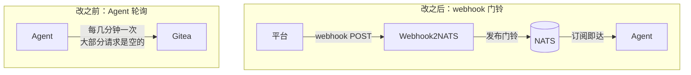

# Webhook2NATS

[English](README.en.md) · 中文

一个轻量的 **Webhook → Core NATS** 实时门铃转发器。

平台（Gitea / Forgejo / GitHub / GitLab / 任何会发 Webhook 的系统）推事件，
这个通道负责**校验签名、去重、解析「该通知谁」**，然后把一个只含元数据的精简
事件发布到 NATS，让在线的 Agent **毫秒级**被叫醒——而不是靠轮询定时抓。

- **运行环境**：Python 3.12 + `nats-py`，打成很小的 Alpine 镜像。
- **传输**：纯 **Core NATS**（即时、at-most-once、纯内存）。
  **没有 JetStream、不存消息历史、没有数据库。**
- **定位**：只做通知。**不存正文、不标已读、不代替任何 Agent 行动。**
  来源平台始终是事实源。

## 镜像

```bash
docker pull ghcr.io/sopyk/webhook2nats:latest
```

| | |
|---|---|
| 仓库 | **`ghcr.io/sopyk/webhook2nats`**（GitHub Container Registry，公开、匿名可拉） |
| 架构 | `linux/amd64` + `linux/arm64` |
| 稳定版 | `:latest`、`:1.0`、`:1.0.0`、`v1.0.0` |
| 预发布 | `:X.Y.Z-rcN` 之类的预发布号 —— **不会**移动 `:latest` |

> 上面刻意写成 `X.Y.Z-rcN` 而不是具体版本：文档里出现字面量版本号，
> 到下个版本就会变成一个没人更新的旧数字。仓库里有一条测试在盯着这件事
> （`test_deploy.py::test_no_stale_version_literals_anywhere`）。

`:latest` 只跟正式版走。预发布版本只挂自己的号，别人 `docker compose pull`
拿到的永远是已发布的稳定版；CI 里有一条断言在强制这条规则，预发布若产出
`latest` 会直接构建失败。

想确认手上跑的是哪一版：

```bash
curl -s localhost:8090/version
# {"status":"ok","version":"1.0.0","commit":"22c6f52…","started_at":…,"uptime_seconds":…}
```

---

## 它解决什么问题

一队 Agent 每几分钟轮询一次代码托管平台：空请求很多，延迟最多一个轮询周期。



<details>
<summary>纯文本版（终端、Docker Hub 等不渲染 Mermaid 的地方）</summary>

```
   改之前                                改之后
┌────────────┐  轮询   ┌────────────┐    ┌────────────┐ webhook ┌──────────────┐ 门铃    ┌────────────┐ 发布    ┌────────────┐
│   Agent    │ ─────▶  │   Gitea    │    │    平台    │ ─────▶  │ Webhook2NATS │ ───▶    │    NATS    │ ───▶    │   Agent    │
└────────────┘  分钟级 └────────────┘    └────────────┘ 毫秒级  └──────────────┘ 即时    └────────────┘ 即时    └────────────┘
  延迟上限 = 一个轮询周期                                延迟上限 = 一个网络往返
  空请求 = 大部分轮询                                                          空请求 = 0
```
</details>

**「门铃」而不是「内容」**：NATS 上只有 `repo / number / actor / mentions /
url / delivery` 这些元数据，Agent 被叫醒后自己去平台拉完整内容。
这样即使有人伪造门铃，里面也只有公开元数据和 URL。

**去重保证「不重复处理」，不保证「恰好一次投递」** —— 详见
[失败与重试语义](docs/architecture.md#失败了会怎样)。

---

## 三分钟跑起来

```bash
# 1) 准备两个被 gitignore 排除的文件
cp relay.env.example relay.env      # 填 NATS 账号 + NATS_PASSWORD + WEBHOOK_SECRET
mkdir -p config
#    config/members.json 里填 登录名 → {host, id} 映射（决定谁会收到门铃）
#    可选：cp config/webhook2nats.example.toml config/webhook2nats.toml

# 2) 起
docker compose up -d

# 3) 确认
curl -s localhost:8090/healthz        # → {"status": "ok", ...}
```

想从源码构建：`docker compose -f docker-compose.build.yml up -d --build`。

完整挂载关系、镜像 tag 的取舍、以及**单实例约束**（去重状态是本地的，
一个 webhook 回调只能指向一个 relay，多实例会重复下发且无任何报错）
见 [运维手册](docs/operations.md)。

---

## 基本使用场景

**订阅端**（你的 Agent）——先订阅，确认在线，再去平台上操作：

```bash
nats sub 'evt.>'
```

> ⚠️ 两个必须知道的点，都曾让验收误判成「服务坏了」：
> 1. **先订阅再触发**。Core NATS 不留存消息——事件发布那一刻没人在听，
>    消息就永久消散了，而 relay 仍然会回 `accepted`（它确实发出去了）。
> 2. **订阅 `evt.>`，不是 `evt.gitea.notify.>`**。定向门铃
>    (`evt.gitea.notify.<host>.<id>`) 和全厅公告 (`evt.gitea.broadcast`)
>    不在同一个命名空间下，订阅窄了**收不到公告且不会报错**。

**来源端**（Gitea）：把 Webhook 回调地址填成 `http://<relay>:8090/gitea-hook`，
密钥填 `relay.env` 里同一个 `WEBHOOK_SECRET`。

**不配 Gitea 也能验证** —— 手工敲一个签名正确的请求：

```bash
nats sub 'evt.gitea.notify.h1.alice' &

cat > /tmp/hook.json <<'JSON'
{"action":"created",
 "repository":{"full_name":"org/repo"},
 "sender":{"login":"you"},
 "issue":{"number":134,"title":"t",
          "html_url":"https://g.example/org/repo/issues/134","state":"open","labels":[]},
 "comment":{"html_url":"https://g.example/org/repo/issues/134#issuecomment-42",
            "body":"@alice 帮忙看看"}}
JSON

SIG=$(openssl dgst -sha256 -hmac "$WEBHOOK_SECRET" /tmp/hook.json | sed 's/^.* //')

curl -i -X POST http://127.0.0.1:8090/gitea-hook \
  -H "X-Gitea-Event: issue_comment" \
  -H "X-Gitea-Delivery: 11111111-2222-3333-4444-555555555555" \
  -H "X-Gitea-Signature: $SIG" \
  --data-binary @/tmp/hook.json
```

得到 `{"status": "accepted", ...}`，订阅端立刻打印出门铃 JSON。
**把同一个 `X-Gitea-Delivery` 再发一遍** → `{"status": "duplicate"}`，
且订阅端**不会**多出一条——这是本地验证去重生效最快的方法。

> 用 `--data-binary` 而不是 `-d`：后者会吃掉文件里的换行，导致发出去的字节
> 和算签名的字节不一致，恒定 401。

---

## 核心能力

| | |
|---|---|
| **多平台** | 头名 / 验签算法 / 事件映射 / 路由路径全部来自配置，接新平台不用改代码 |
| **幂等** | delivery UUID 去重：inflight 占位 → 发布确认 → 落盘；失败回滚让平台能安全重试 |
| **中文 @提及** | 紧邻汉字也能匹配；代码块、邮箱、路径里的 `@` 不误触 |
| **不存正文** | 消息只含元数据 + URL，Agent 自己去拉全文 |
| **配置外置** | 镜像里零环境值，同一个不可变镜像在任何环境都能跑 |
| **可观测** | 每请求一行结构化日志，带 `delivery`，能按它和 NATS 消息精确对上号 |
| **日志降级** | 日志目录不可写时自动退回 stdout + 一条警告，**不会**让服务起不来 |

完整的逐项状态（含已知限制）见 [`docs/reference.md`](docs/reference.md#实现状态)。

---

## 排障

**先看日志**——每请求一行，`delivery` 与 Agent 收到的消息里那个 UUID 相同：

```bash
docker logs webhook2nats 2>&1 | grep 'delivery=<uuid>'
```

`status=200 decision=accepted` 说明 relay 侧完全正常，问题在订阅端（多半是
订阅时机）。日志字段说明、日志里**不会**出现什么、以及 `mentions` 里有某人
而 `subjects` 里没有他意味着什么，都见 [运维手册](docs/operations.md#日志)。

---

## 文档

| 文档 | 讲什么 | 适合谁 |
|---|---|---|
| [架构与设计](docs/architecture.md) | 为什么这么做、一个事件端到端走一遍、设计取舍 | 所有人，建议先读 |
| [接入一个平台](docs/integration.md) | 加一个新平台要声明哪六件事、Gitea 的事件头对照、配置里的坑 | 要扩展的人 |
| [参考](docs/reference.md) | 全部协议契约：subject / 消息格式 / HTTP / 配置项对照 / 实现状态 | 写 Agent 的人、查参数的人 |
| [运维手册](docs/operations.md) | 部署、日志、排障、验收注意点、测试套件 | 部署与值班的人 |
| [Docker Hub 镜像说明](docs/dockerhub-description.md) | 往 Docker Hub 页面贴的中英对照文案 | 发布镜像的人 |

模板文件：[`config/webhook2nats.example.toml`](config/webhook2nats.example.toml) ·
[`relay.env.example`](relay.env.example)

本文档有[英文版](README.en.md)（摘要版，细节仍以中文文档为准）。

## 开发

```bash
python3 test_deploy.py        # 文档↔配置模板↔compose 是否漂移
cd relay
python3 test_internals.py     # 配置校验、归一化、@提及、去重、路由、隐私
python3 test_relay.py         # HTTP 端到端：真 socket、真 HMAC
python3 test_logs.py          # 日志：降级、隐私、限流、轮转
python3 test_e2e.py           # 仿真：keep-alive / 注入 / 并发 / 真实 NATS
```

共 **278 条**，不需要真实 NATS 或外网（`test_e2e.py` 会自己拉一个容器）。
详见 [测试说明](docs/operations.md#测试)。