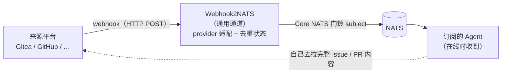

# 架构与设计

本文解释**它为什么这么做**。只想把它跑起来，看 [README](../README.md)。

### 为什么要做

一队 Agent 每几分钟轮询一次自建的 Gitea：空请求很多，延迟最多一个轮询周期。这个转发器插在来源平台和 NATS 中间——平台每个事件推一次 Webhook，转发器校验、压缩、解析收件人，然后往 NATS 发一个「门铃」。在线的 Agent 毫秒级收到；离线的 Agent 本来就收不到（这是 Core NATS 的设计），由另一条**低频巡厅**兜底对账（对账依据是来源平台的未读状态）。

### 架构



<details>
<summary>纯文本版</summary>

```
┌──────────────┐  webhook（HTTP POST，平台各自的签名算法）  ┌──────────────────┐  Core NATS   ┌──────────────────┐
│  Gitea /     │ ────────────────────────────────────────▶ │   Webhook2NATS    │ ───────────▶ │  订阅的 Agent     │
│  GitHub / …  │  issues / issue_comment /                 │  （通用通道）      │  门铃 subject │ （在线时收到）    │
│              │  pull_request / pull_request_review       │                    │              └──────────────────┘
└──────────────┘                                           └──────────────────┘
         ▲                                                          │
         │ Agent 自己去拉完整 issue/PR 内容                          │ provider 适配 + 去重状态
         └──────────────────────────────────────────────────────────┘
```

</details>

每个事件的处理流程：

1. **来源平台**发出 webhook；
2. **Webhook2NATS** 校验签名、按 delivery UUID 去重、依据**外部挂载的成员映射**解析收件人（@提及 / 指派 / 请求评审），然后发布一个精简 JSON 事件（控制在 1 KB 以内）；
3. **NATS** 扇出给匹配的在线订阅者。

如果没有订阅者在线，Core NATS 按设计丢弃——低频巡厅是保证不漏的兜底。**这个服务故意不做持久化存储。**

---

### 跑一遍：一个真实的 Gitea 事件

> 下面这一节用一个具体事件把整条链路走一遍。所有时间、ID、URL 都是示意值，
> 但**字段名、subject 结构、状态码都是真实契约**。

**场景**：09:30:00，你在 `org/repo` 的 issue #134 里 @ 了一个 Agent——alice。

### 09:30:00.003 — Gitea 发出 Webhook

Gitea 把事件 POST 到你配的回调地址（本服务默认 `POST /gitea-hook`）：

```http
POST /gitea-hook HTTP/1.1
X-Gitea-Event: issue_comment
X-Gitea-Delivery: 6f1c0a2e-8b3d-4f7a-9c1e-2d5b7a0e4f83
X-Gitea-Signature: 3f2a9d1c...            ← HMAC-SHA256(request_body)

{
  "action": "created",
  "repository": { "full_name": "org/repo",
                  "html_url": "https://gitea.example/org/repo" },
  "sender": { "login": "you" },
  "issue": {
    "number": 134,
    "title": "评审流水线的重试策略",
    "html_url": "https://gitea.example/org/repo/issues/134",
    "state": "open",
    "labels": []
  },
  "comment": {
    "html_url": "https://gitea.example/org/repo/issues/134#issuecomment-42",
    "body": "@alice 这个重试上限你看要不要设成 3？"
  }
}
```

三个头各司其职：**事件类型**决定走哪条归一化逻辑，**delivery** 是幂等去重的依据，**签名**是信任边界。

### 09:30:00.005 — 转发器做的四件事

1. **验签** —— 用 `WEBHOOK_SECRET` 对**原始请求体**重算 HMAC-SHA256，`hmac.compare_digest` 定长比较（不用定长比较就能用时序侧信道逐字节爆破）。→ 通过
2. **去重占位** —— `6f1c0a2e…` 进 inflight 集合。此刻还**不算**已处理，只是占住坑位防止重试并发投递。
3. **剥代码 → 抽 @提及** —— 先把 ```` ``` ```` 代码块和 `` ` `` 行内码整段抹掉（防止把示例代码里的 `@alice` 当真），再从剩下的正文抽 `@alice`。
4. **查成员映射** —— `members.json` 里 `alice → {host: "h1", id: "alice"}`，拼出收件位：

```
evt.gitea.notify.h1.alice
   └──前缀──┘ └host┘ └id┘
```

> `@某人` 不在成员映射里**不会路由**（也就不会打扰到无关的人），但名字会留在事件的 `mentions` 字段里，供界面展示「这条提到了但没部署 Agent 的人」。

### 09:30:00.011 — 门铃上线

relay 把精简事件发到 NATS，然后 `flush()` 等服务器确认。**只有确认成功**，才把这个 delivery 落盘成「已处理」，并回 `200 accepted`。

alice 那边收到的就是这一条：

```json
{
  "kind": "issue_comment",
  "action": "created",
  "repo": "org/repo",
  "actor": "you",
  "ts": "2026-10-10T09:30:00Z",
  "number": 134,
  "title": "评审流水线的重试策略",
  "url": "https://gitea.example/org/repo/issues/134",
  "state": "open",
  "assignees": [],
  "labels": [],
  "comment_url": "https://gitea.example/org/repo/issues/134#issuecomment-42",
  "mentions": ["alice"],
  "delivery": "6f1c0a2e-8b3d-4f7a-9c1e-2d5b7a0e4f83"
}
```

**注意里面没有「这个重试上限你看要不要设成 3」这句话。** relay 刻意不搬运正文——门铃只负责说一声「134 号 issue 上有个跟你有关的动静」，正文由 alice 自己回 Gitea 拉。这是它能被摆在打穿影响面里的前提：即使伪造门铃，里面也只有公开元数据和 URL。

> `ts` 是接收时刻的 ISO-8601 时间戳。Gitea 的 webhook payload 里**没有**时间字段，
> 所以这里取的是 relay 收到请求的时刻 —— 够 Agent 排序和判断新鲜度，不代表事件在平台上的真实发生时间。

### 09:30:00.015 — alice 醒来

从收到门铃到她能开工，中间隔着一次 Gitea API 调用（拉 issue 全文 + 评论 + 关联 PR）。从你按下回车到 alice 被叫醒，**十几毫秒**；对比原来 5 分钟一轮的轮询，延迟上限从「一个轮询周期」降到「一个网络往返」。

### 如果 alice 当时不在线？

Core NATS 没有订阅者就丢弃，这是设计而不是 bug。alice 下次上线**不会**收到这条门铃——**由另一条低频巡厅兜底**，对账依据是 Gitea 的未读状态。

两者的分工要分清：**转发器管「快」，巡厅管「不漏」。** 谁也替代不了谁，所以这个服务才敢不做持久化。

### 失败了会怎样

NATS 没确认（连接断了、flush 超时）时，relay 回的**不是** `200`：

| relay 返回 | 含义 | Gitea 会怎么做 | relay 这边 |
|---|---|---|---|
| `200 accepted` | 全部 subject 已发布并 flush 成功 | 记为投递成功 | **现在才**把 delivery 落盘成已处理 |
| `200 duplicate` | 这个 delivery 早先已经成功处理过 | 记为成功，不再重试 | 丢弃，不重复叫醒 |
| `409 inflight` | 上一次重试还在处理中 | 可能重试 | 不动，等前一次出结果 |
| `502 publish-failed` | 某个 subject 发布失败 | 认为失败，**用同一个 UUID 重试** | **回滚** inflight 占位，这次不算已处理 |
| `504 publish-timeout` | 等待 NATS 确认超时 | 同上 | 同上 |
| `401 bad-signature` | 验签不过 | 认为失败 | 直接拒，不落任何状态 |

关键在于**先发布成功、再记已处理**。反过来做的话，一次网络抖动就会让 alice 永远收不到这条通知，而且没有任何补救机会——因为平台已经被告知「投递成功」，不会再试了。

> ⚠️ **超时路径上有一个无法消除的重复投递窗口**
>
> Core NATS 没有 ack 机制：`publish()` 一执行，字节就写进 socket 了，
> 后面的 `flush()` 只是在等服务器回 PONG。所以当 NATS 卡住、我们放弃等待并回 `504` 时，
> 那条消息**可能其实已经上线了**。平台收到 `504` 会用同一 UUID 重试，于是 alice 可能收到两次。
>
> 能做的只是把窗口压到最小：`flush()` 的超时被设成 HTTP 预算的 80%，
> 让 NATS 先于 HTTP 层放弃。`future.cancel()` 只能中止「等 PONG」，
> 撤不回已经发出去的字节 —— 这一点没有捷径。
>
> **换句话说：去重保证的是「不重复处理」，不是「恰好一次投递」。**
> 下游 Agent 若要严格幂等，应当用 `delivery` 字段自己去重。

### 自己敲一遍

不用真配 Gitea 也能验证整条链路。先订阅 alice 的收件位：

```bash
nats sub 'evt.gitea.notify.h1.alice'
```

再手工发一个签名正确的 webhook：

```bash
# 用 heredoc 写 body，签名必须对**文件里的确切字节**计算
cat > /tmp/hook.json <<'JSON'
{"action":"created",
 "repository":{"full_name":"org/repo"},
 "sender":{"login":"you"},
 "issue":{"number":134,"title":"t",
          "html_url":"https://g.example/org/repo/issues/134","state":"open","labels":[]},
 "comment":{"html_url":"https://g.example/org/repo/issues/134#issuecomment-42",
            "body":"@alice 帮忙看看"}}
JSON

SIG=$(openssl dgst -sha256 -hmac "$WEBHOOK_SECRET" /tmp/hook.json | sed 's/^.* //')

curl -i -X POST http://127.0.0.1:8090/gitea-hook \
  -H "Content-Type: application/json" \
  -H "X-Gitea-Event: issue_comment" \
  -H "X-Gitea-Delivery: 11111111-2222-3333-4444-555555555555" \
  -H "X-Gitea-Signature: $SIG" \
  --data-binary @/tmp/hook.json
```

拿到 `200 accepted`，另一个终端的 `nats sub` 会立刻打印出门铃 JSON。

**把同一个 `X-Gitea-Delivery` 再发一遍** —— 会拿到 `200 duplicate`，且 `nats sub` 那边**不会**多出一条。这是在本地就能验证去重是否生效的最快方法。

> 两个容易踩的点：
> - 用 `--data-binary` 而不是 `-d`：后者会吃掉文件里的换行，导致实际发出去的字节和算签名的字节不一致，恒定 401。
> - `X-Gitea-Signature` 是**请求体的**签名，不是 URL 或某个字段的签名。Gitea 另外还会发 `X-Hub-Signature`(SHA-1) 和 `X-Hub-Signature-256`(带 `sha256=` 前缀)，本服务只认 `X-Gitea-Signature`。

---

### 设计取舍

- **出站 schema 固定，入站适配可配**：那份统一事件 JSON 是**出站契约，定下来就不动**——已经有多个 Agent 在订阅，动一次所有下游都得跟着改，属于破坏性变更。所以 `kind` 保持在四个取值，宁可往里塞也不往外加。入站那头（头名、验签算法、事件映射）各平台差异大且相对稳定，尽量配置化：接新平台应该只是一次 diff，而不是一次发版。
- **平台适配做成声明式配置，而不是运行时插件**：路径、头名、验签算法这些各平台差异很小，写死在代码里每次接新平台都要改代码；声明式配置把它变成改配置。payload 归一化确实各平台结构不同，那部分保留为代码，不硬套进配置。
- **TOML 而不是 .env / YAML**：零新增依赖、重复键报错、口令不会被隐式转型、对 Tab 不敏感——后者对 NAS 上手工编辑配置很关键。
- **不上 JetStream**：Agent 只需要一声即时门铃；离线期间漏掉的，靠来源平台未读状态这条权威对账来源补。持久化队列会重复存储平台已经存的东西。
- **只通知、不行动**：不持平台写权限，不能标已读，不能代替 Agent 发言。
- **配置外置于镜像**：所有环境相关值都挂载/注入，同一个不可变镜像可以在任何环境跑，也才敢公开发布。
